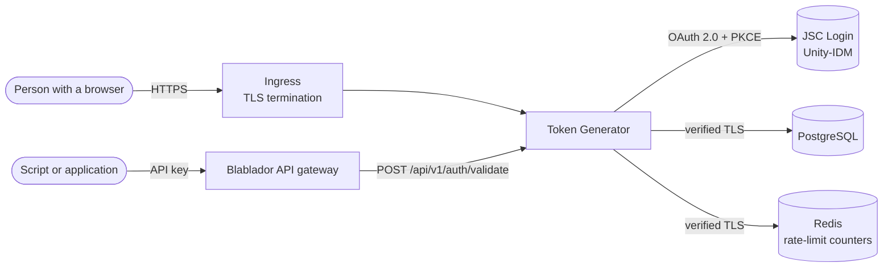

# Blablador Token Generator

The Token Generator issues the API tokens people use to call
[Blablador](https://helmholtz-blablador.fz-juelich.de), the large language
model service of Helmholtz AI at Forschungszentrum Jülich.

People sign in with **JSC Login** (Unity-IDM, OAuth 2.0), create personal API
tokens on a small dashboard, and use them as API keys. The Blablador API
gateway asks this service whether each presented token is valid.

## What it does

- **Self-service tokens.** Create, list, renew, rotate, revoke and delete
  tokens; each new value is shown exactly once.
- **Validation API.** One bearer-authenticated endpoint tells a gateway who a
  token belongs to and when it expires.
- **Administration.** Administrators see all tokens and accounts, manage
  administrator rights, create local password accounts, revoke all of an
  account's credentials during an incident and restore deleted accounts.
- **Defensive by default.** Tokens are stored only as keyed HMAC-SHA256
  digests; sessions use host-only `Secure`/`HttpOnly` cookies with CSRF
  protection and server-side revocation; production mode refuses insecure
  settings at startup. See [Security](security.md).

## Where to start

| You want to… | Read |
| --- | --- |
| Run it on your machine | [Getting started](getting-started.md) |
| Create and use a token | [User guide](user-guide.md) |
| Validate tokens from a gateway or service | [API reference](api.md#validate-a-token) |
| Put it into production | [Production checklist](deployment/checklist.md), then [Kubernetes](deployment/kubernetes.md) |
| Look up a setting | [Configuration reference](configuration.md) |
| Upgrade, back up, monitor or respond to an incident | [Operations](operations/administration.md) |

## Project status

Version 1.0.0 is the first production release. It includes the remediation of
a security review (October 2026) whose report, threat model and
control inventory are kept in the repository under
[`security_audit/`](https://github.com/HelmholtzAI-FZJ/blablador-token-generator/tree/main/security_audit).
Changes are listed in the [changelog](changelog.md).
