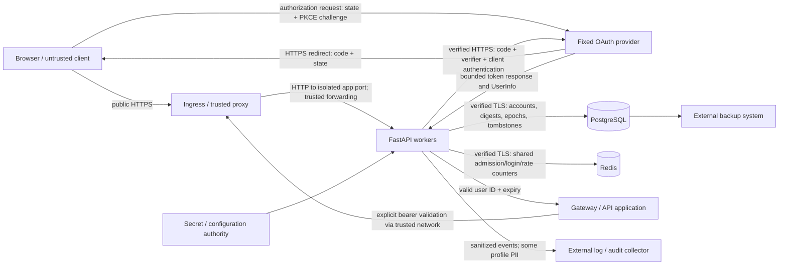

# Token Generator threat model

Reviewed on 2026-10-12 against the application and deployment sources after the security fixes. This document describes the intended production boundary, the controls implemented in this repository, and assumptions that need deployment evidence. It is not evidence that a particular production installation satisfies those assumptions. The finding register and final verification interpretation are in [REPORT.md](REPORT.md). The route and verification inventory is in [CONTROLS.md](CONTROLS.md); dependency and image findings are in [DEPENDENCIES.md](DEPENDENCIES.md) and [CONTAINER_VULNERABILITIES.md](CONTAINER_VULNERABILITIES.md).

## Scope and security objectives

The service authenticates people through one configured OAuth provider or administrator-provisioned local accounts. It issues browser sessions and opaque API credentials, maintains ownership and administrative roles, and answers credential-validation requests from applications or a gateway. Its principal security objectives are:

1. Bind an account to the correct provider subject or local identity; preserve administrative changes across logins.
2. Prevent unauthenticated, cross-origin, or unauthorized users from creating, rotating, revoking, viewing, or deleting another account's credentials.
3. Make successful logout, credential revocation, password changes, role changes, and account deletion durable at the database transaction boundary.
4. Preserve account/token limits and the last-administrator invariant under concurrent requests and multiple workers.
5. Keep plaintext API credentials, passwords, signing keys, HMAC keys, OAuth secrets, and authorization codes out of persistent application data and ordinary application logs.
6. Bound work before body parsing and authentication, and fail predictably when shared security infrastructure is unavailable.
7. Make the production configuration reject known unsafe transport, cookie, secret, and storage choices.

Review covers Python application code, browser templates/scripts, configuration, dependency metadata, container build, startup, Compose/Helm deployment templates, regression tests, and isolated probes. A live identity provider, production database, production Redis, running ingress, cloud IAM, deployed cluster, and downstream model gateway were not exercised. The root review inspected the ignored local configuration only for non-secret security settings and file metadata; secret values were not copied into this audit. Local configuration/cookie-file permissions were tightened as recorded in the main report. Historical exploit probes used explicitly synthetic configuration and isolated databases; their pre-fix observations must not be represented as current failures.

The service does not run inference models. Its model-list configuration is metadata, not a runtime guarantee of context size, model admission, or serving isolation. The standing 262,144-token minimum and the specific Muse Glimmer 30B exception must be verified at the separate serving system before deploying a model.

## Assets and persistence

| Asset | Location / lifetime | Consequence of compromise or corruption |
| --- | --- | --- |
| JWT signing key | Configuration/secret mount or environment; loaded by each worker | Forged browser sessions for existing identities. Database role, tombstone, and epoch checks still run, but possession of this key defeats the signature boundary. |
| API-token HMAC key | Separate configuration secret; also used with domain separation for deletion records and local-account rate keys | Token-digest calculation and identifier guessing become possible. Losing or replacing the key breaks existing token validation and matching of historical deletion records. |
| OAuth client secret | Configuration; sent only to fixed token endpoint | Abuse of the OAuth client, subject to provider code/redirect/PKCE policy. It is not a password for arbitrary local users. |
| Browser JWT | Secure, HttpOnly, host-only `__Host-access_token` cookie; default 24-hour ordinary or 1-hour admin JWT | Replay of that user's application session until expiry, durable `jti` revocation, epoch change, or account disable/delete. JWT is signed, not encrypted; claims are internal user ID, epoch, expiry, and random session ID. |
| CSRF/state/PKCE cookies | Secure, HttpOnly, host-only cookies; OAuth cookies expire in five minutes | Defeating browser request binding or code interception protection. These controls do not survive a compromised application origin. |
| Plaintext API credential | Created/rotated response and user's application or browser; not stored in database | Bearer use at the validation endpoint and whatever access the downstream gateway grants. It does not authenticate browser management/admin routes. |
| API-token database record | HMAC digest, internal owner ID, display name, expiry, revocation and usage dates | Confidential metadata exposure; unauthorized digest/owner/status edits can alter authorization. A database dump alone contains no retrievable plaintext credential. |
| Local password | Transient login/provision/reset input; bcrypt hash persisted | Online guessing or offline password-hash cracking. Password hashes remain sensitive even though API tokens are stored differently. |
| User profile and role | Internal UUID, fixed-provider subject, email, name, password-presence/hash, `is_admin`, session epoch | Personal-data disclosure; role or identity edits can grant application privileges. The database writer is inside the authorization trust boundary. |
| JWT revocation records | `jti`, owner FK, expiry; expired records purged during later logout operations | Removing records re-enables a still-current stolen session unless epoch/account/expiry checks independently reject it. |
| Deletion records | Domain-separated HMAC of provider subject and normalized email plus deletion time | Prevent automatic account resurrection. These are pseudonymous, linkable records, not proof of irreversible anonymization. |
| Rate counters | Shared Redis in production; fixed-window counters are transient | Counter bypass or service denial. Redis restart/loss resets budgets; it does not restore revoked credentials because authorization state is in PostgreSQL. |
| Audit events, backups, images, configuration and TLS materials | Application stderr, external collectors, database volumes/backups, registry, secret mounts | Credential/PII disclosure, supply-chain compromise, loss of incident evidence, or rollback of revocation/deletion state. External retention and access policy are unverified. |

Schema and delete behavior are in [models.py](../app/models.py), [database.py](../app/database.py), and [tombstones.py](../app/tombstones.py). OAuth emails are profile data rather than account-linking identifiers. Distinct provider subjects may legitimately have the same email; local normalized email is unique only among local accounts.

## Actors and adversary capabilities

| Actor | Assumed capabilities | Main threats |
| --- | --- | --- |
| Anonymous internet client | Arbitrary URLs, headers, cookies, request bodies, concurrency, distributed source IPs | Brute force, malformed payloads, resource exhaustion, forged JWTs, OAuth login CSRF, probing of administrative functionality. |
| Malicious website / sibling origin | Induce cross-site browser navigation or requests; no access to this origin's HttpOnly cookies or same-origin DOM | CSRF, login confusion, cookie planting where host-prefix guarantees are absent. Origin compromise or trusted proxy compromise is a stronger capability. |
| Ordinary authenticated user | Own session, account, API credentials, arbitrary profile/token names and requests | Ownership bypass, stored/DOM XSS, privilege escalation, quota races, deletion/restore confusion. |
| Attacker holding a stolen browser session | Replay a valid cookie and use pages that expose its CSRF value | Account and credential management within that user's role. CSRF is not protection against session theft. |
| Attacker holding an API credential | Submit explicit bearer header | Downstream API use and user-ID/expiry validation. Browser session/admin permissions are separate. |
| Malicious or compromised application administrator | Manage any user, reset local passwords, change roles, revoke/delete credentials, explicitly restore identities | Authorized high-impact abuse. The application does not provide approval quorum, independent second factor, or separation of administrative duties. |
| Compromised identity provider / provider tenant | Control asserted subjects/profiles, authorization codes, UserInfo and login assurance | Account impersonation and bootstrap-admin abuse. Provider honesty and stable unique subjects are necessary trust assumptions. |
| Proxy/gateway/cluster/registry/DB/Redis/secret administrator | May change trusted client IP, network reachability, deployment/configuration, code or persisted state | Rate/exemption bypass, credential disclosure, forged authorization state, malicious image rollout, denial of service. These are trusted operational roles and need separate least-privilege controls. |

## Data flows and trust boundaries

1. **Internet to ingress.** TLS termination, correct host routing, header/body/connection limits, and the integrity of forwarded client-IP headers belong to the deployed ingress. Application HTTPS configuration and HSTS express policy; they do not create a certificate or prove that HTTP is redirected at the edge.
2. **Ingress to workers.** The container listens on HTTP port 8080. The Helm app NetworkPolicy requires explicit trusted ingress/gateway peers and production egress rules; source forwarding is restricted through `FORWARDED_ALLOW_IPS`. If direct access or an overly broad trusted peer permits spoofed forwarding, IP budgets and gateway exemptions become bypassable. Correct source IPs, selectors, CNI enforcement, and pod-to-pod confidentiality need live verification.
3. **Browser to application origin.** HttpOnly/Secure/host-prefix cookies bind sessions to the host. Double-submit CSRF cookies and form/header checks bind unsafe cookie-authenticated requests. Template autoescaping, DOM escaping, and restrictive script CSP protect the origin. A browser extension, stolen cookie, arbitrary same-origin script, or compromised static asset crosses this boundary and can act as the user.
4. **Application to fixed provider.** Server-side HTTPS requests go to configured token/UserInfo URLs, do not follow redirects, are bounded by timeout and response size, and validate response types. Provider endpoint configuration is privileged input; it is not supplied by arbitrary request parameters. TLS CA trust and the identity provider's tenant, policies, PKCE support and subject lifecycle are external assumptions.
5. **Worker to shared persistence.** PostgreSQL holds authoritative identity, role, revocation and deletion state. Redis holds shared admission/login/rate counters. Verified TLS, separate DB runtime/admin identities, secret injection and NetworkPolicy are implemented in production templates; deployed certificates, actual grants, Redis ACLs, backup encryption and operator access remain operational checks.
6. **Validation to downstream authorization.** `/api/v1/auth/validate` proves that one presented API credential currently maps to an enabled account. The response contains user ID and expiry. Model/resource entitlement, per-user serving quota, tenant isolation, gateway cache duration and replay policy are downstream responsibilities. This service must not be treated as evidence that every permitted model/resource request is authorized correctly.
7. **Code/build/secret authority to runtime.** A source, dependency, image, deployment manifest or secret writer can alter these controls. Digest-pinned base images, locked dependency export, non-root execution and read-only root filesystems reduce accidental drift and containment risk; they do not prove registry provenance, CI trust or absence of vulnerabilities. The image-risk inventory and release gate must be consulted separately.

## Authentication and identity-binding assumptions

**OAuth authorization-code flow.** `/login` stores random state and PKCE verifier in short-lived host cookies, sends `S256`, and uses one fixed redirect URI. The callback checks state/verifier before sending the code and verifier to the fixed token endpoint; it then calls the fixed UserInfo endpoint with the returned opaque bearer token. No provider bearer token is persisted. Provider profile validation requires a bounded subject/email and strictly typed `email_verified`.

The implementation does **not** validate an ID token's signature, issuer, audience, nonce, `auth_time`, `acr`, or `amr`, and does not compare UserInfo `sub` to an ID-token `sub`. Its security model is a fixed-provider OAuth code plus HTTPS UserInfo flow, rather than a fully validated OpenID Connect relying party. State and PKCE materially bind the transaction. Missing nonce alone is not a demonstrated attack in this authorization-code implementation: nonce is optional in this flow, and the application does not consume a submitted ID token. See [OpenID Connect authorization-code request parameters](https://openid.net/specs/openid-connect-core-1_0.html#AuthRequest). A standalone unauthenticated token-substitution exploit was not established against an honest fixed provider and the implemented state/PKCE checks. Strict OIDC requirements or high-assurance login should use a complete maintained OIDC client and explicitly verify all applicable ID-token/UserInfo bindings. See the primary [OAuth security guidance](https://www.rfc-editor.org/rfc/rfc9700) and [OpenID Connect UserInfo requirements](https://openid.net/specs/openid-connect-core-1_0.html#UserInfoResponse).

The database stores a provider `sub` in `unity_id` without an issuer namespace. That is coherent for the one configured provider. Adding another issuer/tenant, changing provider, or reassigning subjects requires an explicit identity migration and namespace strategy. Subject uniqueness and non-reassignment are provider assumptions; matching emails must never be used as a shortcut to link accounts.

**Administrative bootstrap.** Configured subjects, or trusted verified emails, can grant an administrative role only when a new OAuth account is created. Existing roles are database decisions changed by administrative endpoints; config additions do not silently promote old sessions, and config matches do not undo a demotion. `trust_provider_emails=true` deliberately transfers email-verification assurance to the configured provider. Prefer explicit stable subjects for bootstrap and keep the provider/email-trust assumption visible. Explicit restoration followed by creation is a new bootstrap event and should be considered when retaining bootstrap configuration.

**Local login.** Only administrator-provisioned local rows with password hashes authenticate locally; OAuth accounts never inherit a password through email matching. No public local registration exists. New/reset passwords require at least 15 characters, reject the configured small common-password list, and fit bcrypt's 72-byte maximum. Existing shorter passwords are still accepted for compatibility. Legacy API tokens with NULL expiry also remain accepted until revoked; new creation, renewal and rotation produce bounded expiry. Login always performs a bcrypt check, including unknown identities, and runs it outside the event loop under a bounded capacity budget. This reduces one timing signal; it is not a proof that all database/network timing is indistinguishable. The bundled blocklist is small and does not replace an organizational compromised-password policy.

**Browser session.** Each request checks signature/expiry/required claims, database `jti` revocation, a freshly loaded user, deletion record and session epoch; admin routes also check the persisted role. The admin JWT has a shorter default one-hour lifetime; the browser cookie can remain for the ordinary 24-hour cookie lifetime, but an expired admin JWT is rejected. No MFA, step-up challenge, recent-authentication check, user session listing, idle-timeout policy or local self-service password reset is implemented here.

## Revocation, deletion and concurrency model

| Event | Intended durable result | Important boundary |
| --- | --- | --- |
| Successful logout | Persist current JWT `jti` revocation, then clear browser session cookie | Other sessions and API credentials remain valid. A revocation-storage failure returns 503 and does not claim successful logout; the route raises before successful-response cookie clearing. |
| Local password reset or actual role change | Atomic database epoch increment invalidates all prior browser sessions | Existing API credentials are not automatically revoked. Changing only a name does not invalidate sessions. |
| Self revoke-all or admin revoke-credentials | Mark all affected API credentials revoked and increment session epoch in one transaction | Includes the acting user's current session if targeting self. Account still exists and can authenticate again. |
| API credential rotation | Replace stored digest with a new credential value | Old credential fails new validation queries; only the new response exposes plaintext. Renewal changes lifetime, not the credential value, and does not un-revoke a credential. |
| Account deletion | Store tombstone and delete account, tokens and session-revocation rows transactionally | No user row means sessions/tokens cannot authenticate. Upstream IdP account remains unchanged. Backups/logs and retained tombstone privacy policy are separate. |
| Restore local identity | Administrator explicitly creates local account and lifts local-email tombstones | Does not lift an OAuth subject tombstone sharing that email. |
| Restore OAuth identity | Administrator explicitly removes the selected subject tombstone | Allows a future OAuth login; does not restore previous tokens/sessions and may cause bootstrap rules to run for a newly created row. |

Atomic SQL epoch increments avoid stale ORM lost updates. Token mutations lock the owner; administrator membership changes serialize through the database; mutation routes recheck the presented session after obtaining the lock. Last-administrator protection counts usable, non-tombstoned administrators rather than disabled orphan rows. It checks up to 100 alternative candidates: if none is usable and additional rows remain, it fails closed with 503 and requests explicit review/cleanup instead of risking the last usable administrator. Disabled rows can be demoted or deleted by an authenticated usable administrator. PostgreSQL is the production concurrency authority. SQLite `BEGIN IMMEDIATE` serialization exists for development/testing; separate SQLite replicas are unsupported.

OAuth account creation checks deletion before and after persistence. If a concurrent deletion leaves an orphan row observed after creation, session issuance fails closed and an explicit `cleanup_required=True` event is emitted. The implementation preserves the row for administrator investigation rather than automatically deleting a possibly legitimate concurrent restoration. Future session and API validation paths also check tombstones.

Revocation takes effect for subsequent authorization checks after commit. An already authorized read or validation request can complete while a revoke transaction commits; downstream cached authorization can extend the practical exposure. Authenticated writes that wait for account locks are revalidated after locking to prevent stale sessions from minting replacement credentials following containment. The application cannot retract a response already delivered to a client.

## Availability and abuse model

Admission runs before request-body parsing and authentication dependencies: default shared 240/minute per effective client IP, per-worker maximum 128 concurrent ordinary HTTP requests, bounded Redis connect/read timeouts, and explicit 503 on shared admission storage failure. `GET /healthz` is a constant-response fast path inside admission, bypassing body reads, the counter and concurrent slot so dependency outages or saturation do not trigger needless liveness restarts. Response security headers still apply. Readiness is admitted and checks dependencies under a bounded timeout. Exact validation requests from configured gateway CIDRs bypass IP counters and route validation quotas, but still meet body/concurrency/security-header controls. Universal validation exemptions are rejected in production. An allowed exemption is safe only when the source boundary cannot be spoofed or reached by arbitrary clients.

Local login adds a shared normalized-account HMAC counter, default five attempts/minute, plus ten/minute per source IP before bcrypt. The account counter uses the shared storage directly and fails closed on an error rather than inheriting route-level in-memory fallback. The account budget limits distributed guessing but lets an attacker cause temporary denial for a known email; monitoring and administrator policy must account for that tradeoff. Password work has a separate default four-operation capacity per event loop, retained until a canceled request's actual thread work completes.

Body size/time controls and off-loop counter/password work reduce application exhaustion. PostgreSQL connects, statements, locks and idle transactions have bounded configurable deadlines (defaults 5/5/2/15 seconds); index migration statements use 120 seconds. These controls do not cover all distributed denial of service, TLS handshakes, oversized header/query lines, slow headers, ingress queues or aggregate worker/pod capacity. Redis rate-counter loss resets windows; shared admission errors favor bounded denial over silently removing that security layer. Per-route SlowAPI fallback is per worker for routes that perform a quota check; it does not replace shared admission. Configured gateway validation traffic is explicitly exempt from those quotas and retains body/concurrency/database-authorization checks during a Redis outage.

## Error and logging confidentiality

The outer application error-safety middleware catches unexpected HTTP failures before they reach server traceback handling, logs only method, registered route template (or `unmatched`) and exception type, and returns a generic 500 when no response has started. Original exception messages can contain submitted credentials or backend details and are deliberately not propagated. If response headers have already been sent, the middleware cannot change the response status or retract delivered bytes; it raises only a sanitized interruption exception with the original exception context suppressed. Security headers remain on responses handled through the outer header middleware. This is failure containment, not a guarantee that an interrupted response can be completed successfully.

Supported `start.sh`, container entrypoint and direct application entrypoints disable Uvicorn access logging so callback code/state query strings are not automatically captured there. Application audit/account INFO events remain enabled even at higher general logger thresholds. Reverse proxies, alternative launch commands, observability agents and provider logs are independent and still need query/header/body redaction. Application events that include email remain personal data requiring an approved retention/access policy.

## Operational questions requiring evidence

| Area | Required deployment evidence / unresolved assumption |
| --- | --- |
| Identity-provider assurance | Correct client/tenant, exact redirect registration, authorization-code one-time use, enforced PKCE S256, stable non-reassigned subjects, trusted `email_verified`, login admission/group policy, rate protection, MFA and recovery controls. No live-provider test was performed. |
| Credential lifecycle | What disables a user upstream; who calls app containment/deletion; maximum allowed propagation delay; handling of already issued API credentials; emergency signing/HMAC-key changes; downstream cache purge. IdP logout/disable events are not automatically consumed here. |
| Administrator assurance | Upstream or external MFA, recent-authentication/step-up policy for destructive operations, administrator approval and recovery, minimum retained usable admins, monitoring of bootstrap and restore events, explicit cleanup of disabled orphan rows if the bounded availability check returns 503. One-hour JWT expiry alone is not MFA. |
| Transport/network | Public HTTPS/certificate chain and redirect, correct ingress source forwarding, enforced trusted peers and CNI NetworkPolicies, TLS CA/SAN verification for PostgreSQL/Redis, provider egress allowlists, secure DNS, health/readiness exposure. |
| Persistence and migration | Correct existing schema/indexes, actual production locking isolation, separate runtime DB privileges, encrypted backups, restore exercises, prevention of rollback of revocations/tombstones, supported database version. `create_all` is not a general schema-migration system. |
| Secret operations | Independently random keys, secure provision/injection/access, retention and backup of HMAC key, documented destructive effects of rotation, image/config rollout synchrony. No versioned HMAC keyring or online non-destructive token/tombstone key migration exists. |
| Audit and privacy | Central immutable retention, alert rules, operator access, redaction of authorization headers/cookies/bodies and callback code/state queries at every proxy/access logger, PII retention/export/deletion. Some application events intentionally contain email. |
| Downstream authorization | Resource/model/tenant policy, gateway-only access, whether a validation response is cached and for how long, revocation retry/failure behavior, usage quota and model-serving limits. |
| Supply chain / runtime | Reviewed application image digest, current dependency/image scan and gate outcome, trusted CI/registry permissions, actual non-root/read-only execution and resource limits, accepted unresolved CVEs. See the separate inventories. |
| Abuse/load | Expected users behind NAT, gateway exemptions, tuned IP/account budgets, realistic latency/concurrency/Redis-failure behavior, edge connection/header limits and DDoS protections. Local isolated probes are not a load certification. |

The implemented checks and regression tests establish useful application properties. Production acceptance still requires evidence for the trusted components, live transport, identity-provider policy, lifecycle integration, image risk and operational recovery described above.
